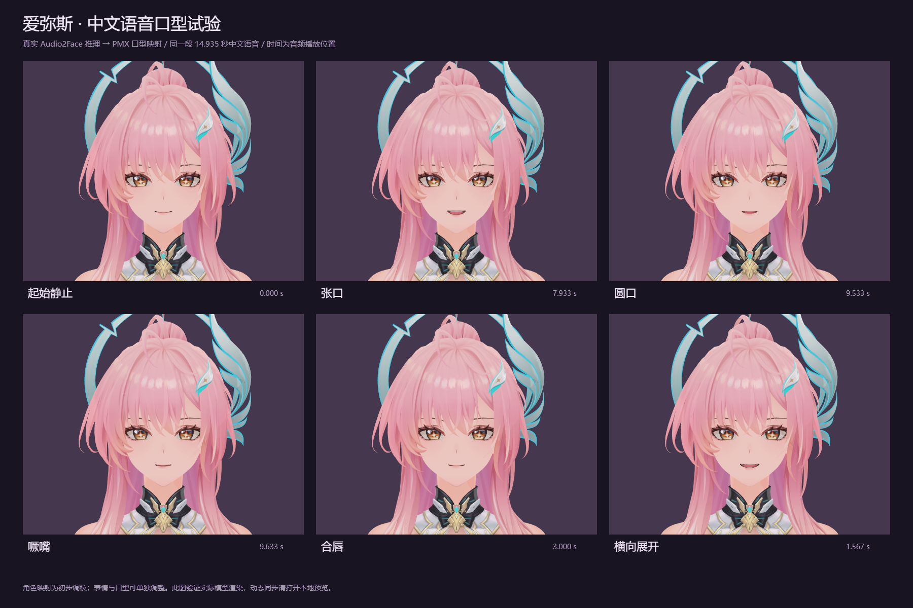

# Aemeath Face Studio

独立的人物表情渲染与 Audio2Face 语音口型驱动试验。包含爱弥斯 PMX、贴图、两套浏览器预览、原生 GPU 驱动程序、中文示例音频、已生成的动画曲线与恢复脚本。



## 先看效果

预览已附带真实推理结果，播放示例不需要安装 CUDA，也不需要重新推理。需要 Windows 和 Node.js 20+。

```powershell
git clone https://github.com/zwh087383/aemeath-face-studio.git
cd aemeath-face-studio
powershell.exe -NoProfile -ExecutionPolicy Bypass -File .\scripts\setup.ps1 -PreviewOnly
powershell.exe -NoProfile -ExecutionPolicy Bypass -File .\scripts\start-preview.ps1
```

- 语音口型：<http://127.0.0.1:18765/>。播放、暂停、定位、调整幅度和同步偏移，对比 Audio2Face 与音量开合，叠加浅笑/认真。
- 八种表情：<http://127.0.0.1:18765/expressions/>。自然、浅笑、开心、疑惑、认真、惊讶、害羞、俏皮；包括五元音单独检查、眨眼、脸红、头部动作、呼吸和对照图导出。
- `start-preview.ps1 -Port 18766` 可以指定其他本机端口。服务只监听 `127.0.0.1`，Ctrl+C 结束服务。

八表情入口的“口型演示”是无音频的循环示意。首页才是按中文音频真实推理结果同步的口型。

## 重新生成口型

需要 NVIDIA GPU、支持 CUDA 12.9 的驱动、Python 3.10+、Visual Studio 2022 的 C++ 编译工具和 Windows SDK，以及 CMake 3.24+ / Ninja。脚本优先自动发现已安装工具，也支持设置 `FACE_PYTHON` 指定 Python。CUDA 和 TensorRT 下载到本项目 `runtime/`，不修改系统级环境或安装显卡驱动。

```powershell
# 安装前端依赖，获取固定版本模型、SDK、CUDA/TensorRT，编译驱动及本机推理引擎
powershell.exe -NoProfile -ExecutionPolicy Bypass -File .\scripts\setup.ps1

# 对已附带的中文音频运行推理：每次输入20ms音频，生成30FPS动画
powershell.exe -NoProfile -ExecutionPolicy Bypass -File .\scripts\run-probe.ps1 -ChunkSamples 320 -FrameRate 30
```

使用自己的音频时，先转换为非空、单声道、16000 Hz WAV，然后指定两个路径：

```powershell
.\scripts\run-probe.ps1 -AudioPath "$PWD\audio\your-voice.wav" -OutputPath "$PWD\outputs\your-voice.json" -ChunkSamples 320 -FrameRate 30
```

此命令导出 JSON；首页仍展示附带的 `chinese-probe.wav` / `chinese-probe.json` / `waveform.json` 三件套。替换展示音频时须同步更新它们，不能把新音频与旧曲线混用。

已有依赖时使用 `scripts/build-local.ps1` 重新构建；更换 GPU 或 TensorRT 时增加 `-RebuildEngine`。CUDA 架构默认探测当前 GPU，也可以传 `-CudaArchitecture 120` 等明确目标。Windows TensorRT 引擎属于本机生成产物，不跨设备分发。

## 项目内容

| 路径 | 内容 |
| --- | --- |
| `preview/` | 音频时钟同步、曲线插值、PMX 口型映射、Three.js/MMD 渲染、本地服务 |
| `preview/expressions/` | 八组表情、呼吸/头部动作/眨眼、单独口型检查与对照图 |
| `native/` | C++ Audio2Face 原生驱动：WAV 输入、GPU 推理、68路曲线及时间/测量信息导出 |
| `scripts/` | 安装、固定版本下载、路径配置、构建、推理、验证、预览启动 |
| `assets/Aemeath/` | 人物 PMX、贴图和原始说明文件 |
| `audio/` | 14.935秒本机中文测试音频 |
| `outputs/` | 已生成曲线、波形、验证数据和真实渲染截图 |
| `manifests/` | 固定模型版本与文件散列、CUDA官方清单、表情参数记录 |
| `vendor/Audio2Face-3D-SDK` | 官方SDK的固定Git子模块 |

Git 保存可运行示例与完整自有源码。`runtime/`、`models/`、`cache/`、`build/`、`logs/`、`node_modules/` 由脚本恢复或本机构建，不进入 Git。完整本地开发环境约8.90GB，其中包含约3.13GB下载缓存；这不是浏览器预览的部署大小。模型约307MB，CUDA/TensorRT约5.06GB。原始文件大小记录见 `outputs/disk-usage.json`。

固定版本：

- Audio2Face SDK：`1ca0f02535ed774f5dbcd724a31cd486368dc783`。
- Claire 2.3.1：Hugging Face revision `a46eafb067adfdd7cc8f5c7941586b309004561c`；逐文件 SHA256 已锁定。
- CUDA redistributables 12.9.1；TensorRT 10.13.2.6 / Windows / CUDA12.9。
- Three.js `0.186.1`、three-mmd `0.1.0`、mmd-parser `1.1.4`，以 npm lockfile 锁定。

## 验证与已知边界

首次试验在 RTX 5070 Ti Laptop 上用14.935秒中文语音生成68路参数（52路标准面部参数与16路额外舌头参数）。30FPS分块输入为449帧/2.488秒；后续60FPS分块输入为897帧/4.789秒。初始化另计。首次60FPS整段运行曾为13.592秒，不能忽略预热、输入方式与桌面负载。详细记录在 `outputs/validation.json`。

每次送入20ms音频的测试，在累计260ms时开始输出首帧；测试没有按实际时间等待每个输入块，260ms描述模型的数据就绪要求，不是完整对话延迟。当前浏览器播放的是预先生成的曲线，依据 `audio.currentTime` 同步，而不是在线连接TTS服务。

原始参数经过数量、有限性、范围、时间单调性、帧间隔与关键嘴部变化检查。浏览器实测了模型渲染、音频播放/暂停/定位、音量对照、偏移调整、表情叠加与图片导出，原始记录在 `outputs/preview-validation.json`。这些记录保留首轮测量的时间与机器路径；仓库整理后的检出验证另见 `docs/publication-validation.md`。

PMX映射是初步手工调校，未覆盖全部68路。圆唇/合唇使用组合约束，眉眼、眨眼、呼吸与手动情绪单独叠加。尚未完成逐音素定量标定、实时TTS接线、自动语音情绪识别或衣服/头发物理。示例声音来自 Microsoft Huihui Desktop，未克隆角色声线。

## 素材与依赖来源

角色素材来自[官方发布页面](https://www.aplaybox.com/details/model/VAUBif86B0mu)，原始作者/素材说明随 `assets/Aemeath/` 保存。第三方素材和依赖保留各自的来源和声明，见 [THIRD_PARTY_NOTICES.md](THIRD_PARTY_NOTICES.md)。本仓库用于私有个人试验，创建时可见性为 **Private**。
