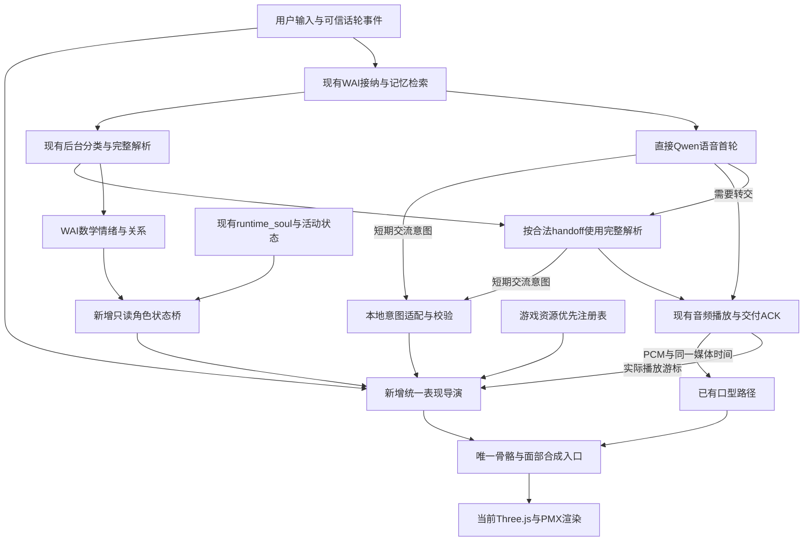

# 虚拟人动作流：适配现有 WAI 的修订架构

日期：2026-10-22。状态：**实验性设计 + 独立本地制作验证；尚未把统一原生资源导演接入正式语音和主 Web。**

参考用户提供的四页《虚拟人动作流架构》（图内日期2026-10-23），以本次实际源码核对为准。保留“交流意图 → 本地选择 → 本地执行”“对话和闲时共用同一个身体”的核心，修正状态所有权、时钟、工具回执及资源接入假设。

WAI检查基线 `8a715a00d5a8bf8b161b86e55e16fe2da349c99e`；face制作前基线 `559e11a96f54bbd980ef71467846c1b5ac611653`。本轮不修改WAI业务，不读写个人记忆数据库，不调用云模型。下文“提议/新增”不能当作已实现接口。

## 1. 最关键的修正

**持续情绪和关系属于WAI数学系统；Qwen生成语音、提出当轮交流意图；本地导演依据真实状态及资源决定动作。**

当前内部是 `E=[V,A,D,S]`（效价、唤醒、支配、压力）与 `R=[L,T]`（亲密、信任）。分类模型可以判断事件类型和强度，数学系统再综合人格、关系、惯性、后效和时间回归计算状态。模型不是完全不参与，但它没有最终情绪向量的任意赋值权。

状态回归的核心形式为：

```text
E_next = baseline + (E - baseline) * exp(-dt / tau_effective)
```

`tau_effective`受已有状态调制，不能在渲染器里另建“mood缓慢衰减”覆盖它。L/T还具有独立长期变化。有效能量来自本轮运行时合成状态；启用V2 life时可能由用户作息计算，不应直接等同于旧soul.energy，更不能由模型的tool.energy重写。

源码：WAI `wai/models/llm_client.py:1181`、`wai/runtime/main.py:2036`、`wai/identity/emotion_relation_dynamics.py:80`和`:195`、`wai/proactive/v2_runtime.py:156`、`wai/proactive/v2_life_runtime.py:128`。

## 2. 已有、实验已有、尚未接通

| 能力 | 当前事实 | 本设计处理 |
| --- | --- | --- |
| 数学情绪/关系、运行时有效能量 | WAI已有 | 只读复用，不复制一套 |
| 记忆检索、纠正投影、后台解析、取消及交付历史 | WAI已有，直接语音实验复用 | 保持所有保护 |
| Qwen直接首轮，必要时转完整解析回复 | 隔离实验已有 | 动作不成为首轮等待条件 |
| D方案语音与工具 | 音频即时转发；完整工具校验后提交本地；response.done后回receipt | 保留已测事件顺序，不改成未经验证的“立即ok” |
| 角色权威状态向前端连续外发 | **缺少正式字段/桥** | 提议新增只读AvatarStateBridge |
| 主Web角色舞台 | 仍是图片/全息占位 | 不把face实验页当作生产3D已接通 |
| face原创库 | 113个本地目录指令 | 不等于Qwen全都能调用 |
| 现有云端动作工具 | 8表情、22 gesture选项（含none/头部/旧身体） | 复用旧工具适配，暂不把全部素材塞进prompt |
| 原生游戏身体/衣发/表情/注视 | 已提取、独立浏览器预览 | 优先建立可用资源注册表，再接统一导演 |
| 字幕语义旁路 | 有另一个实验；当前direct客户端sidecar:false | 作为可选补充，不声称所有旧实验同时工作 |
| 字级语音对齐 | 当前材料无精确真值 | 短语锚点是带置信度的估计 |

WAI主快照见 `wai/runtime/main.py:603`，主舞台见 `webui/src/components/CharacterStage.tsx:86`；直接回复见 `wai/runtime/direct_voice_runtime.py:25`。face实时目录见 `realtime/avatar/controller-bridge.mjs`，工具见WAI `tools/voice_avatar/duplex_transport.py:44`。本轮是源码审计，不冒充重新完成云端或物理麦克风验收。

## 3. 修订后的数据流



图中的“新增”是后续接线点。本轮独立预览验证skill制作方法，不把整张图冒充实现。

## 4. 三类状态分开，只有一个权威来源

| 类别 | 来源 | 更新尺度 | 可影响内容 | 禁止的写入 |
| --- | --- | --- | --- | --- |
| 角色持续状态 | WAI数学E/R、runtime_soul | 现有后台节拍和事件 | 表情底色、动作稀疏程度、幅度范围、恢复速度 | 模型工具/字幕不改长期数值 |
| 交流意图 | 校验后的工具、可信事件、低置信文字线索 | 当前话轮或短事件 | 解释、让话、确认、道歉等行为候选 | 不自设epoch、优先级、永久mood |
| 执行状态 | 本地导演和播放器 | 渲染/音频节拍 | 当前姿态/速度、占用层、playhead、取消 | 不反向伪造对话交付或记忆事实 |

礼貌微笑、认真解释、道歉姿态是短时表达，可以与角色慢情绪不同，但必须有边界并在结束后回到状态基底。`thinking`是阶段，`apologetic`常是交流功能，不宜都塞进mood枚举。

## 5. 最小角色状态桥（新增提议）

从已提交的`state_bus.get_emotion_dict()`、与本轮同口径的`runtime_soul`、可信运行时事件组合只读状态。不能直接消费未提交的分类模型输出。

建议契约示意：

```json
{
  "schema": "avatar-state.v1",
  "sessionId": "assigned-by-host",
  "stateStreamId": "assigned-by-host-bridge-instance",
  "stateSeq": 42,
  "sampledAtMonoMs": 120350,
  "emotion": {"V": 0.2, "A": 0.3, "D": 0.4, "S": 0.1},
  "relation": {"L": 0.5, "T": 0.5},
  "physiology": {"effectiveEnergy": 0.7, "sleeping": false, "source": "runtime_soul"},
  "phase": "listening"
}
```

这些数值仅为格式示例，`stateSeq`等是新桥字段，不是现在已经存在的emotion revision。跨进程时必须进行单调时钟域转换或发送相对年龄，不能直接比较两个进程的monotonic零点。只允许有限公开字段；不把完整记忆、画像或提示词日志送到渲染器。

快答开始先用上一份有效权威状态。后台本轮分析合法提交后再平滑更新；无新增分类模型调用，也不等待当前分类才首播。桥断开时保留可信状态并降级为安静表达。重连通过可信握手取得新stateStreamId和完整快照，再接受该流递增stateSeq；旧流的在途高序号消息仍被拒绝，不能仅把同一session的seq归零。状态重连不回放旧动作事件。

## 6. 工具只提交流意图，保留D方案时序

先兼容已有`perform_avatar`，将其作为短期表现建议而非长期情绪真值。后续工具可逐步改为下列窄语义：

```json
{
  "communicativeAct": "acknowledge_correction",
  "keyAction": "none",
  "timing": "after_speech",
  "anchor": ""
}
```

宿主为语音cue添加`session/turn/connection/response/epoch/callId`、时间、有效期和优先级；这些不由模型自由传入。倾听/闲时没有response时使用独立interaction/activity generation，不能伪造responseId。白名单、参数范围和去重后才产生候选。工具失败或晚到只影响表现，不拦住音频输出。

现有D代码在`response.done`后回工具receipt，且`displayConfirmed:false`。要分清：**参数被接纳、动作实际开始、动作完成、语音完整播放**四种回执。前三种均不能替代语音最终ACK，也不能据此写入完整助手历史。仅有perform_avatar而没有语音时如实记录，不自动再请求一轮模型掩盖失败；合法request_full_reply允许首段零音频并转交第二个Qwen，这个既有转交能力保留。

## 7. 两种时钟与因果对齐

### 有语音的cue

口型及语义手势以当前回复**实际消耗的媒体帧**为准。`bytes/48000`只在PCM24k、16bit、mono、计数确实代表已消耗输入帧且重采样映射正确时成立。收到、解码或排入队列的字节不是已播放量。硬件输出延迟/物理停声另测。

暂停与欠载停止媒体cue推进。direct两段保留不同provider connection/response身份，但共享一个逻辑媒体epoch与累计播放时间；第二段局部cue加`segment.startFrame/sampleRate`偏移，不在Qwen2开始时重置逻辑时钟。取消及最终ACK覆盖完整段组。已取消的音频不能因新连接重用编号而继续驱动动作。

### 没有语音的行为

倾听、闲时、眨眼、呼吸及打断恢复使用本地单调时钟；WAI情绪自然回归仍由WAI自己的时间推进。音频停止不应冻结收势或令人物成为静止雕像。

### 对PDF锚点公式的修正

句内字数插值要知道句子的总时长，而实时句尾尚未到达时这个量未知。因此PDF示例的精确锚点公式是**事后估计或带预测的启发式**，不能同时承诺零额外缓冲和精确提前命中。静音段也不等于语法句，字幕与语音可能并非固定先后。

建议优先使用可靠的发声开始/结束与现成动作的prepare/stroke标记；只有短语已确定且剩余可调度时间足够时使用anchor。before_speech只有意图在开播前到达且余量足够时成立，不为等待动作新增音频缓冲。提前量按动作准备段确定，不统一减200ms。迟到的非必要动作丢弃，重要指令降级为简短确认或明确未执行；不默认把错过的鞠躬/挥手补到无关句尾。文字否定、引用、用户思考停顿不直接触发摇头或点头。

## 8. 游戏资源优先，但先检查能不能用

选择顺序：

1. 已验证、语义合适、起始姿态/场景兼容的原生身体片段，带准确配套衣发。
2. 原生表情pose和注视样本，使用受控过渡与独立通道所有权。
3. 对缺少的交流过程创作小型反应层，复用原生待机或身体底层。
4. 保持当前姿态、安静倾听，必要时不动。

不能因为资源来自游戏就绕过硬条件。坐姿需要椅子/支撑，转身需root与空间，手势需足够时长，碰撞和上下文不满足则不选。把319身体条目全部用文件名直接暴露给Qwen并不能得到可用动作库。

注册表应逐步补齐：语义功能、姿态族、root策略、占用骨/面部通道、entry/loop/exit、prepare/stroke、可中断区、目标需求、衣发配对、场景/道具、复用来源和验证级别。先做小而可靠的常用子集，保留未标注资源为待审阅。

**非重复创作**比较现有游戏与原创候选的动作内容和交互过程。改名、镜像、变速不算新增。事件条件化的保持/分支可以是新能力，但要说明复用底层；在无全库语义标签情况下，不承诺“全游戏绝无相似动作”。

## 9. 选择与合成

先硬过滤，再按语义、状态、姿态连续性、时机与近期重复打分。候选必须包含`none/hold`。明确用户动作请求在兼容候选内稳定执行；仅在意义接近的安全候选间做带种子的有限随机选择。

softmax温度只决定随机性，不能直接等于性格活跃度。动作频率预算、幅度、速度、随机性分别控制。对慢状态使用阈值回滞/最短保持，避免跨阈值抖动；同一事件只能消费一次。

用一个合成入口写身体：原生身体 → 配套衣发 → 被允许的受限反应/注视修正 → 必要IK/约束 → 实际蒙皮。具体层顺序按部位所有权决定，而不是所有层无条件相加。大幅身体变化会使衣发失配，需要对应素材或验证，不能只用骨骼mask就宣称解决穿插。

脸部将情绪基底、交流表达、眨眼和发音分通道仲裁。发音拥有开合和元音，情绪不能强行闭嘴；眉眼/嘴角也要处理竞争，不能最后写入者无声覆盖。目标位置可靠且关节可用时才采用受限IK/注视；当前摄像机不等于真实用户三维位置。

## 10. 打断、闲时及历史保护

可信barge-in立即撤销旧回复owner，停止旧音频并丢弃旧cue；从当前显示姿态/速度进入短恢复。对于有接触约束的全身动作，可在本地执行安全收势，但不等待远处的中断点才停声。

取消响应不等于取消输入事实：用户刚说的纠正和已合法更新的数学状态保留，旧input_generation的后台结果仍由WAI拒绝。不要在flush里清空长期情绪、有效能量或记忆。

闲时直接适配WAI已有activity/life/proactive模块，不新增另一个“每几分钟调用LLM”的永久循环。保存活动步骤和可恢复检查点；恢复前再验证场景/物体/新任务，不从过时的身体帧盲目续播。

## 11. 延迟与稳定性优化

- 首音频不等待动作选择、表情识别、资源加载、短语对齐或新模型。状态消息合并为最新值，动作事件保留唯一身份。
- 预载少量常用资源和表情字典；其它按需异步缓存，缺素材即时退为保持。原始游戏数据不通过模型prompt传输。
- 动作边车队列有界，过期cue直接丢弃；不要在每个音频块做全资源搜索或写磁盘日志。
- 渲染本地消费播放时钟，不依赖Python往返每帧下发指令。跨进程只传事件、状态和必要时钟校准。
- 记录“为什么选/拒绝/降级”、源状态版本、owner、计划与实际开始时间，便于复现；日志不保存完整私密对话作为默认调试资料。

## 12. 实施顺序与验收

本轮：修订架构、制作skill、让独立代理使用skill制作一个新反应、真实模型预览与打断验证。详细结果另见本批验收记录。

下一批建议：只读状态桥+兼容旧tool适配 → 少量原生资源注册表 → 统一合成入口接D/direct → 最后增强短语/韵律。不要同时改情绪方程、替换引擎、改语音协议和批量扩工具。

必要验收：

- E/R/有效能量只能来自权威源；旧状态与旧owner拒绝；模型mood不回写。
- 首轮无新增模型调用和等待；资源缺失/边车异常不影响语音。
- 暂停/欠载按真实媒体时间；静默和打断收势仍运行。
- 不同阶段打断、工具迟到/重复、连接重建、双段转交、状态更新竞争。
- 用户纠正保留；取消助手不写完整历史；动作回执不替代语音ACK。
- 实模受保护骨、近肘、身体幅度、快挥手、面部发音所有权及衣发作用。
- 轨迹/驱动成本与浏览器性能分开；自然度需要连续观看。独立预览、离线重放、真实云模型、物理麦克风是不同验收等级。

## 13. 本轮证据入口

- 技能源码：`skills/native-performance-authoring/SKILL.md`。
- 本机已安装副本：用户Codex skills目录中的`native-performance-authoring`，发布物不带绝对个人配置路径。
- 私有PDF提取与审计：`outputs/architecture-skill-20261022/`。
- 原生制作研究：`outputs/production-techniques-20261022/`。
- 原始游戏资源保持本机；本报告及技能不携带原生包、模型、密钥、口型曲线或个人记忆。
