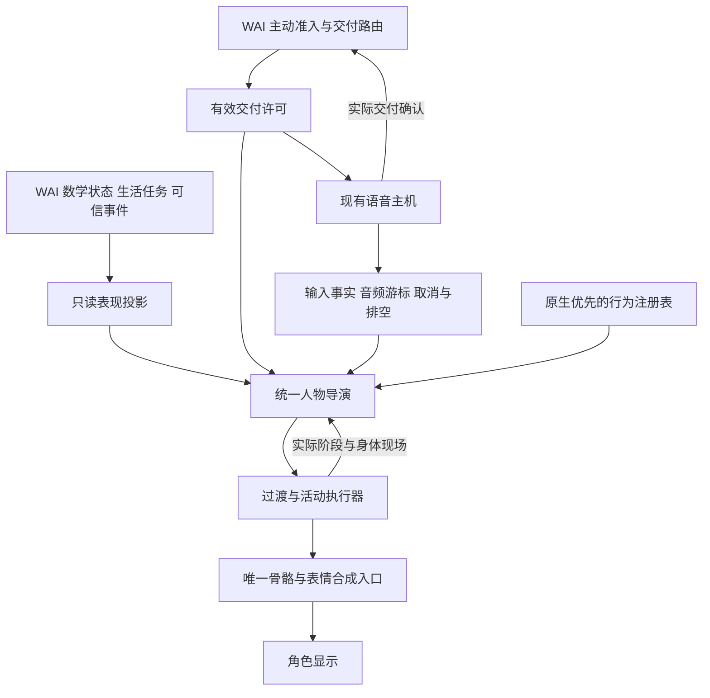

# 统一角色调度中心设计

日期：2026-10-23。状态：设计与源码交叉审阅完成，未实现统一调度中心，未修改运行链路或进行新云端测试。

目标是让角色的闲时活动、注意转移、倾听、说话、收势与主动搭话形成连续行为。统一中心负责决定此刻应该怎样表现；WAI 继续负责数学情绪、内心与生活任务、是否发言，以及记忆和交付结算。

最重要的状态原则是：**身体在做什么、注意谁、用户是否正在输入、自己的音频是否正在播放，分别保存。** 她可以坐着拿书、听用户讲话，并处于一个尚未结束的对话中。收到用户发声时，优先转移注意力，身体按原有支撑与持物条件让出；不强制站回标准待机。

本设计延续 `avatar-flow-wai-adaptation-2026-10-22.md`，细化的是跨闲时与对话的调度职责。以下字段、接口和模块名均为拟议契约，只有标为现状的项目属于当前代码。

## 用户能够观察到的五种行为

| 情况 | 希望看到的连续行为 | 核心条件 |
| --- | --- | --- |
| 闲时由内心和事件驱动 | 持续一项有理由的活动，偶尔回应新事件；没有理由时安静陪伴 | 合法活动、表达倾向、舞台条件共同决定，不轮播随机动作 |
| 闲时转交谈 | 先注意到用户，再收住冲突动作；可保持坐姿和持物 | 原始声音不直接视为合法打断，支撑和物体不能消失 |
| 对话中自然表现 | 倾听、理解、准备、表达和让话有区别，身体与脸表达同一个交流目的 | 意图清楚才做语义手势，口型跟随真正播放的声音 |
| 交谈转回闲时 | 说完收势，留出继续交谈的空间，逐渐放松，条件合适再恢复活动 | 一句音频播完不等于整场交谈结束，业务任务恢复另有权限 |
| 休闲转主动搭话 | 有了有效发言许可后转向用户、准备开口；被用户抢先开口可撤回 | WAI 掌握主动权限，动作不能拖住语音，也不能擅自发声 |

## 当前程序的接入事实

源码基线：WAI `8a715a00d5a8bf8b161b86e55e16fe2da349c99e`；face `616ddc07af8e386298e436b57e9e3d0fde8c6d20`。本轮检查源码默认值，未读取机器私有运行配置；环境覆盖是否开启另行验收。

| 模块或现状 | 可复用部分 | 本次设计必须补齐的边界 |
| --- | --- | --- |
| WAI `wai/proactive/v2_flags.py:5`，`heartbeat.py:535` | 默认启用 V2 Outlet 与 Life Threads；V2 tick 后返回 | 默认旧随机虚拟活动关闭，不能把旧 ActivityEngine 当作现行主驱动 |
| `wai/identity/emotion_system.py:148` | 数学情绪和关系状态 | 只读投影给人物，不另造情绪积分器 |
| `wai/proactive/v2_life_runtime.py:128`，`v2_runtime.py:156` | 闲时生活状态、回复使用的有效运行状态 | 统一导出时保留来源与适用范围，不能一律取旧 soul.energy |
| `wai/presence/inner_frame.py:115` | 短暂主观倾向 | 源码明确非权威，只作低权重提示，不授权说话或写记忆 |
| `wai/proactive/activity_planner.py:158` | 业务任务开始、暂停、恢复、成果状态 | 当前用户到场后约 600 秒静默才恢复任务；人物不必僵持倾听十分钟 |
| `wai/proactive/v2_life_runtime.py:664`，`life_threads.py:180` | 后端根据来源确定 reading、tidy、creation | 数字阅读不等于持实体书，任务 running 不等于此刻 provider 仍在执行 |
| `wai/proactive/v2_outlet.py:168,184,383` | 有效性检查、预约、撤销、最终 ACK 与预算结算 | 原预约不自动等于一个音频播放许可，需协商交付模式和唯一接收者 |
| `wai/runtime/main.py:3355`，`direct_voice_runtime.py:18` | 主动文本分段交付与独立用户直达语音链 | 尚未发现 PROACTIVE_SPEAK 接入 direct voice；主动语音是新增适配 |
| `wai/presence/realtime_presence.py:416` | 文本队列与话轮代次 | running 是待投递文本段，不是扬声器是否在出声 |
| face `realtime/scheduler.mjs:92` | 音频 owner、实际游标、过期丢弃、取消 | 只有粗粒度槽位，不能负责全部无声活动和持物约束 |
| `realtime/activities/director.mjs:4` | 活动序列与 generation | 当前主要是播完下一段，没有一般性的任务挂起恢复 |
| `preview/core/full-body-controller.js:34` | 空中先落地、落座保持、位置连续 | 坐姿遇非坐姿动作可能自动站起；桥接也未普遍继承入射速度 |
| `realtime/activities/props.mjs:259` | 手掌挂接、家具和物体显示 | 省略手持物仍可能让其消失，应建立独立接触与物体状态 |
| `preview/core/skill-reaction.js` | 事件条件化、速度接续、身份与理解门控 | 适合作为行为契约样板，不直接升级成全局导演 |
| 原生资源预览 | 319 个 body ready，9 个 look ready，243 个 ribbon ready | ready 主要指解码等检查，尚无完整支撑、语义、安全出口契约 |

## 一个逻辑中心和四项职责

建议新增本地 `EmbodiedDirector`。它是当前角色表现计划的唯一仲裁入口，接收后端只读投影和现有语音主机的媒体事实。后端不逐帧发骨骼角度，导演不自己调用回复模型。



中心内部保留四项清楚的职责：

1. **事实视图**：收取合法状态、活动、话轮、媒体与场景信息，标记来源、时效和未知状态。
2. **候选生成**：继续当前活动、回应新事件、表达交流意图、保持当前姿态。候选数保持小，不搜索全库。
3. **选择与占用**：检查场景、姿态、来源、期限和通道竞争，再考虑延续收益、切换成本及重复程度。
4. **执行与反馈**：提交一个可撤销的计划，推进阶段和过渡；每帧只采样、合成和渲染。

有新可信事件、阶段到界、动作完成或条件失效时才重新选择。渲染帧不执行语义判断，不每帧抢远程锁，也不等待网络取决策。

## 状态分开保存

| 状态 | 权威来源 | 例子 | 不能混淆的含义 |
| --- | --- | --- | --- |
| 情绪与关系 | WAI 数学系统 | 唤醒、压力、亲密与信任 | 礼貌微笑不是长期情绪变开心 |
| 业务活动 | WAI Life | 资料整理暂停、产物已完成 | 角色翻一页不等于完成资料阅读 |
| 身体活动实例 | 本地已接纳执行计划 | 坐姿、右手握杯、正在放低杯子 | 对话开始不删除这一现场 |
| 注意对象 | 本地导演受可信目标约束 | 用户、手中物、环境、保持 | 摄像机位置不等于真实用户位置 |
| 输入活动 | 现有采集与话轮链 | 疑似发声、已接受用户话轮、合法打断 | 原始 VAD 不自动授权取消当前回复 |
| 输出状态 | 当前媒体 owner | 准备、播放、欠载、暂停、排空、取消 | 文本生成完成不等于声音播完 |
| 交谈关系 | WAI 对话连续性 | 等待回答、允许继续、收束 | 无声一秒不等于可以退场 |
| 主动许可 | WAI 准入与交付路由 | 有效预约、被撤销、过期 | 冷却结束或闲得太久不授予说话权 |

输入与输出不互斥。双工时可能同时收到用户声音并继续输出，直到已有话轮系统确认需要打断；导演最多先做可撤回的注意反应。

同理，身体活动与交流状态不互斥。进入倾听可以保留坐姿和握书，只停止新的翻页与冲突手势。

## 闲时怎样由内心和事件驱动

闲时选择遵循“来源提出倾向，场景提供可做的事，导演选择表现”的顺序。状态变化可以改变候选偏好，但不能单独证明某个具体动作应该发生。

后端只向人物端投影必要的公开表现信息，例如 `quiet_focus / reflect / rest / neutral`。这些标签是新契约中的白名单，来自已验证的活动类型或有效状态，不从私人任务标题、原始内心独白、记忆正文、URL 关键词在前端猜测。私人、失效或不确定来源退回中性表达。

| 有效来源或事件 | 可形成的候选 | 需要避免的推断 |
| --- | --- | --- |
| 已批准的数字资料工作 | 安静专注、短暂沉思、减少无关手势 | 自动拿出一本书，或声称已读完某页 |
| 已有活动想继续，场景仍满足 | 留在当前姿势、续接合法检查点 | 每次重新选一个新动作来制造变化 |
| 有效能量较低，当前没有交谈承诺 | 降低活动强度，选择原生放松或休息候选 | 仅凭一个数值强制睡觉、起身或改变业务任务 |
| 可信新事件需要关注 | 短暂转移注意，必要时让出当前活动 | 每个内部通知都演一次惊讶 |
| 用户明确允许的舞台休闲与现有道具 | 坐着持书、喝水、伸展等已验证活动 | 把舞台演出写成真实完成的生活成果 |
| 无新理由 | 继续当前活动或 hold | 按固定秒数轮流挥手、挠头、叹气 |

区分两类活动：`approved_task` 只是业务事实的表现投影；`ambient` 是角色舞台中的休闲行为，没有业务进度和成果结算。舞台身体动作仍需要真实存在的书、杯、椅子等场景条件。任何纯表现的“翻页完成”都不能推进 WAI 的资料阅读进度或重复增加能量。

候选先通过硬条件检查，再按下列因素排序：表达目的是否匹配、是否延续当前意图、身体是否容易接续、是否会打扰用户、近期是否已重复、执行成本是否合适。可以用加权评分实现，但权重是可调表现参数，不能冒充人的心理公式。

始终提供经当前支撑与接触条件验证的保持或最小稳定收势候选；更换动作必须比延续这一候选有明确收益。加入最短保持和切换惩罚，重大可信事件可以越过保持时间。轻微随机变化仅用于意义和条件接近的候选，不决定是否发声，也不把持续内心状态每帧转换成新动作。

## 五条过渡的完整处理

### 闲时进入交谈

疑似用户声音只触发低承诺注意变化。已有链路确认用户发声或接纳话轮后，停止新启动的分心动作，眼神、头部先回应；需要撤销音频时，仍由现有话轮宿主执行合法打断。

身体向最近的已验证安全保持点让出。正在翻页可以落稳这一次翻页，正在喝水可缩短撤杯路径，正在落座则完成承重转移。坐姿、当前世界位置和持物关系持续存在。

短交流可边保持原活动现场边回应。长交流需要更多手部空间时，才考虑把书或杯放到可信支撑面。没有安全可用的放置路径，就保持持物并使用另一只手或头脸表达；不能凭空删掉道具。

### 交谈中的自然表现

把倾听、理解确认、等待回复、表达和让话作为交流功能。倾听微动不表示同意；有明确理解与完成事实后，才使用确认性的点头。等待云端响应时保持注意，可以有一次克制的准备变化，不能随等待时间循环点头或焦躁换姿势。

Qwen 的短期意图决定“这句话想怎样交流”；WAI 状态调节强度与节奏；本地资源条件决定最后选择哪个具体版本。原生坐姿解释与站姿解释属于不同兼容候选，通用挥手不能导致坐着的人自动站起。

动作、眉眼、嘴角共享同一个交流事件及阶段，但各部位的起落可以有设计过的时间差。持续情绪提供缓慢变化的基底，短时表达结束后回到基底，不一律回 neutral。口型独立跟随实际音频，情绪与道具不得关闭发音通道。

每个确定的语义机会最多接纳一次主动作，字幕增量只更新同一机会的证据，不按块触发。大动作、语义重复和微反应分别限频；句子没有合适动作就只说话。迟到的无关动作丢弃，不挪到下一句补演。

### 一句说完但仍可交谈

显示侧定义 `output_settled`：逻辑回复组已经终结、实际音频已排空、没有等待的转交或后续语音段。这个条件允许人物收手、稍微放松，并继续面向用户。

`output_settled` 不等待历史 ACK、记忆维护或预算落盘。它也不结算这些业务。欠载、用户暂停、Qwen 第一段结束但等待第二段，都不满足这个条件。

收势后保留可继续交流的姿态。如果刚问了一个问题或对方还持有话轮，继续等待。姿态可以自然放松，但不能用一个固定静音倒计时抢先恢复强分心活动。新声音或新输入随时可以再次获得注意。

### 交谈结束回到闲时

现有对话策略允许脱离后，导演逐步减少面向用户的占用，再检查活动书签。可以先进入安静陪伴，随后恢复舞台休闲；真正业务任务的恢复仍遵守 WAI 的暂停与恢复规则。

WAI 当前约 600 秒的业务静默门槛不能作为人物保持强倾听的时长；同样，人物几秒后放松也不代表业务任务已获准恢复。

恢复前检查：来源还有效吗、任务有没有被用户否决、物体和支撑还存在吗、当前姿态能否进入原检查点？条件失效则重选或保持。书签保存的是可恢复阶段，不是强制跳回被打断那一帧。

### 休闲进入主动搭话

WAI 负责判断有没有值得说的内容、是否适合打扰、预算和来源是否有效。人物导演不因闲时计时器到期自行请求模型。

候选阶段最多保留普通的注意变化；只有有效交付许可到来，才准备明确朝向用户的搭话姿态。选择成本低、容易撤回的准备，音频准备与身体让出并行。语音主机在提交及首包播放时复核许可和输入代次，身体没有准备好就少做动作，不能为了完整起身或挥手等待。

音频真正开始后，才进入这次主动发声的表现阶段。若用户先开口，撤销旧预约对应的准备与语音；回到倾听，不补播过期招呼。没有首包或生成失败时，恢复到普通注意姿态，不反复演开口。没有回应也不自行断言被拒绝，不连续催促；后续由 WAI 的主动策略决定。

## 主动语音需要补齐的交付接入

当前 V2 Outlet 预约与 PROACTIVE_SPEAK 主要服务文本交付，不能原样当作音频许可。建议新增 `ProactiveDeliveryAdapter`，复用同一来源、预算和历史结算体系，但明确 `deliveryMode`、实际接收者、唯一 claim、输入代次及有效期。

原业务 `channel` 与新媒体 `deliveryMode` 分开保存。`wai/proactive/urge.py:118` 会根据离开或睡眠状态选择留言等渠道；主机有语音能力不等于可以把留言外放。路由仍需通过当前安静/主动暂停策略、目标会话与设备和 outputOwner 的许可；不能因连接到扬声器就把 leave 自动升级为即时发声。

新路由需要在交付前选择文本、语音或同一组内的文字伴随语音。不能让已有文本消费者先确认全部内容，语音消费者再把同一次搭话结算一遍。媒体能力未协商或适配未完成时保留现有文本路径，人物不假装张嘴发声。

一个拟议 offer 包含：

```text
reservationId, deliveryGroupId, businessChannel, deliveryMode,
sessionId, recipientId, claimToken, ownerGeneration, leaseUntil,
inputGeneration, expiresAt, approvedContent, presentationIntent
```

交付 claim 是宿主级控制，绑定上述会话、接收者、预约和模式；递增 ownerGeneration 使旧消费者失效。它只在交付路由/接管边界处理，不增加人物逐帧远程锁。故障后只有能证明尚无内容交付时，才允许原组变更路由；已经部分出声或结果未知时，不自动把整段改成文本或语音重播。

已有文本是获准内容或生成约束；如何由现有 Qwen 语音主机产生受约束的流式声音，需要实现阶段明确并用有界云批次验收。不能默认将已有文本再自由生成一遍而保证原意不变。不得把主动内容伪造为用户输入来调用 direct 接纳、写入用户历史或再次触发记忆流程。

一组交付只使用一个既有结算入口。实际字幕和实际已交付内容由交付系统核对，草稿不自动代表全部播出。导演的 `visual_started/completed` 仅是可见行为反馈，不能 confirm 主动事件，也不能结算发言预算。语音有效性检查沿用现有保护和已优化的本地状态路径，不重新在每个音频块引入额外账本 IO。

当前 `V2Outlet.confirm` 会结算全部已预约来源并记录预算，不能只传一段 partial visible_text 就把完整组确认。首次语音适配应仅在全组实际交付完成后调用 full confirm；打断或部分交付走专门的 partial/cancel 处理，保留确实已交付的历史，不把未播来源标为 spoken。预算、重试和未知用量沿用现有 owner 的规则，并在接入时专项验证。

## 身体活动和实体连续性

身体活动采用以下生命周期，交流可以在中间覆盖允许的注意和表情通道：

```text
entering → active → yielding → suspended → resuming → active
active → exiting → completed
任意阶段收到撤销 → revoked_pending_settle → abandoned
```

撤销立即使旧计划的后续语义动作失效；最小稳定收势另由本地执行。空中不能冻结，单脚步态仍要落脚，正在交接物体必须明确由谁接管。保持支撑和道具是保持约束与实体连续性，不是把一切骨骼定格。

建立 `BodyContext`，至少保存支撑类型、脚与座椅接触、位置朝向、当前活动实例、手持物和每个对象的 owner。物体只通过明确 acquire/transfer/release 事件变化，下一帧省略某个字段不等于删除物体。双手向桌面放书的交接在一次提交中完成，不能手和桌子重复拥有或同时丢失所有权。

活动书签包括来源表现 revision、动作阶段、合法恢复点、支撑与对象引用、身体位置、失效时间、恢复策略。真实语义进度只引用 WAI 已有状态；纯舞台休闲只有视觉阶段。恢复可以重新进入某个 loop，不要求从旧帧续播。

请求让出时，执行器先返回 `yield_requested` 或 `revoked_pending_settle`，达到合法检查点才返回 `suspended`。截止时间到达仍未让出时返回 `deadline_missed/degraded`，列明占用通道；新意图可只用已释放的头脸，不能伪造“已挂起”。

## 选择优先级和资源规则

先满足支撑、持物、有效身份和发音所有权等硬约束，再比较意图优先级：

1. 既有链路确认的撤销与用户打断，以及新的注意需求。
2. 当前交谈承诺、明确请求与澄清表达。
3. 已获有效许可的主动搭话准备。
4. 有来源且仍适合的自我活动。
5. 无任务时保持与低强度陪伴。

高优先级不意味着可以破坏接触，也不意味着一律占用全身。注意转移可先提交头眼计划；身体动作和与它语义耦合的表情则整组接纳，失败时明确换兼容版本或整体降级。不要在内部造成“手已经执行，脸永远等待”的半套动作。

资源可按支撑/root、躯干、左右臂手、头颈/注视、眉眼、嘴角、发音等划分。实际 mask 必须依据骨架依赖校验，转头也会影响头发，不能只看名字不重合就认为互不干扰。姿态族和通道所有权共同限制叠加。

保留已经验收的主动作身体幅度、近身肘部和利落挥手节奏；小反应使用较小幅度不意味着全局削弱现有主动作。跨动作连接需在实际蒙皮上检查接缝与衣发，不能只凭参数范围宣布自然。

复用原生资源优先顺序：已验证的完整行为及配套衣发 → 兼容的原生身体与表情组合 → 经验证的新局部反应 → 保持或减少动作。没有语义合适的原生动作时，不为了“原生优先”硬选不合适素材。

首批只登记少量常用站姿、坐姿、思考、倾听、解释和带出入口的休闲活动。每条登记：来源、表达标签、支撑入/出、需要的物体、占用/可让出通道、enter/loop/exit、安全让出窗口、接触事件、root 策略、衣发配对、恢复点和验证证据。现有 63.1 秒待机段或 15.83 秒坐姿开始段，没有验证退出能力前不自动进入易被交谈打断的闲时队列。

原生重定向与程序活动当前都可能写全身，必须改为输出受控姿态层，由同一个 compositor 最后提交。不能只是把现有几个 director 同时 tick。

## 时钟 身份和故障处理

语音口型与语义 cue 使用实际消费的媒体帧。Qwen 直接首段与后续完整回复共享逻辑媒体时间和动作预算，后段加累计偏移，旧段 cue 不污染新段。语音暂停与欠载不推进尚未播放的语义动作。

注意转移、活动阶段、到期和收势使用本地单调时钟；WAI 自己的数学时间保持原有职责。跨进程时间必须转换或携带相对年龄，不能直接比较不同进程的 monotonic 数值。

身份按领域分开：状态流使用 `stateStreamId/seq`，活动使用 `activityGeneration`，交互使用可信 `inputGeneration`，语音使用已有 response/connection/media owner，表现计划使用 `planId/revision`。取消旧语音只撤销关联短时表达，不清掉仍有效的活动、道具或 WAI 已接纳的用户纠正。

本地通道占用只在接纳、事件或阶段切换时更新，无逐帧远程续租。跨标签页只允许一个被当前交付宿主认可的执行者提交完成回执；镜像页不重复结算或请求主动发言。浏览器获得焦点不能直接抢走正在出声页面的 owner。

后台恢复可见时先取得新状态与媒体快照，再检查期限，丢弃积压 cue 和过期预约。隐藏期间实际未执行的活动不能按墙钟直接报告完成；RAF 停止不等于音频结束。资源缺失、过渡不可行或调度异常时保持可信现场或执行最小稳定收势，语音继续使用现有独立链路。

## 最小接口与实现位置

建议按以下边界实现，路径是拟议新增位置，并非本轮已经创建：

| 位置 | 职责 |
| --- | --- |
| WAI `wai/presence/avatar_state_projection.py` | 白名单投影数学状态、非敏感活动表现和有效来源 |
| WAI `wai/runtime/avatar_presentation_bridge.py` | 版本化事件、重连快照、现有话轮与媒体事实适配 |
| WAI `wai/runtime/proactive_media_delivery.py` | 主动交付能力协商、唯一 claim 与现有语音宿主适配 |
| face `realtime/embodied/director.mjs` | 事实归并、候选选择、通道仲裁与计划 revision |
| face `realtime/embodied/activity-session.mjs` | 身体活动生命周期、恢复书签与场景检查 |
| face `realtime/embodied/transition-planner.mjs` | 报价和提交过渡，明确接触保持、让出窗口与降级 |
| face `realtime/embodied/resource-registry.mjs` | 少量已验证的原生行为契约及原创补缺候选 |
| face `preview/core/pose-compositor.js` | 单一骨骼/形变提交，原生、程序、表情和口型仲裁 |

最小执行接口：

```text
inspect() -> 当前身体 支撑 对象 通道占用 revision
quoteTransition(intent, expectedRevision) -> 可行计划或降级理由
commit(plan, owner, expectedRevision) -> accepted 或 stale/rejected
yield(owner, mode) -> requested；到安全点再回 suspended
resume(bookmark, currentFacts) -> accepted 或 replan_required
tick(localTime, mediaCursor) -> 本帧受限姿态层
```

报价与提交之间若状态已变，拒绝旧计划；不在新事件后继续执行旧报价。反馈至少区分接纳、实际可见开始、安全让出、完成、撤销和降级。反馈默认只进入调度与诊断，不反向生成新心理事件；确需影响 WAI 的活动事件应由其显式验证和幂等接纳，避免自我触发循环。

每次选择保留精简原因记录：来源事件、有效状态版本、候选被选或拒绝的理由、占用通道、计划与实际开始时间。保持或不动也有原因。记录不保存私人任务正文，不按每帧或音频块写磁盘，便于区分“没有合适动作”“被持物占用”“指令太晚”和“渲染未执行”。

## 分批实现与验收

| 批次 | 实现范围 | 应该能证明什么 |
| --- | --- | --- |
| A | 只读状态/交互桥，确定性事件重放，身体现场与道具状态，少量原生行为契约 | 来源权威、无旧包复活、坐姿与持物连续；没有新模型等待 |
| B | 统一合成与过渡，接现有 direct 音频游标，覆盖闲时与交谈往返 | 真实模型不突跳、不强制站起，口型隔离，音频不等身体，打断可恢复 |
| C | 主动交付唯一 claim 与现有语音主机接入，实际交付核对 | 主动出声权限正确，用户抢先开口可撤销，无双重 ACK/预算/历史 |
| D | 扩展经验证的活动族和少量更精细的交流意图 | 自然度改善且仍有稀疏节奏，没有大量随机动作 |

首期不做全库两两过渡、不引入额外内心模型循环、不改情绪方程、不把全部素材塞进 Qwen 工具。先覆盖少量正确的支撑与姿态族。速度衔接优先复用 skill 新反应经验，但不能把其参数 C1 测试推广成全身任意碰撞姿态已经验证。

至少覆盖以下验收场景；本轮仅制定预期，尚未执行这些新系统测试：

| 场景 | 通过条件 |
| --- | --- |
| 没有新事件，只有慢情绪变化 | 安静延续或保持，没有虚构业务成果、没有固定周期手势轮播 |
| 数字阅读任务正在运行 | 最多出现非字面的专注倾向，不自动生成书本与阅读进度 |
| 坐着持书时被叫到 | 抬眼抬头，坐姿和书保留，冲突翻页在安全点停止 |
| 举杯时用户开口 | 杯子保留，短程让出；口型仍跟随实际音频，不以撤杯结束阻塞发声 |
| 落座或单脚步态中被打断 | 完成最小承重转移，无冻结半空、吸附地面或瞬移站起 |
| 用户句中停顿或回声触发 VAD | 保持话轮承诺，只有既有系统认定的打断才能撤销输出 |
| 等回复数秒且字幕分多块 | 不重复点头，增量块不等于动作次数，语音不等待动作 |
| Qwen 第一段转交第二段 | 累计时间和动作预算连续，段间不误退闲时 |
| 说话挥手时用户纠正 | 旧音频/动作撤销，从当前姿态速度收回，用户纠正仍保留 |
| 最后字幕已到、语音未排空 | 不提前收尾，欠载/暂停不冒充播放完成 |
| 音频已排空但历史 ACK 慢 | 可正常收势和安静等待，不因此提前结算，也不僵持到 ACK |
| 交谈结束但业务恢复尚未许可 | 视觉放松，业务仍暂停；不把 600 秒当强倾听时长 |
| 主动准备后用户先开口 | 唯一许可失效，收回准备，不重播过期搭话 |
| 主动文本与语音消费者同时存在 | 同一交付组只有一个有效 route/claim，最终只结算一次 |
| 用户离开或睡眠时主机支持语音 | 留言不会因媒体能力变为即时外放，原渠道约束仍有效 |
| 主动声音部分播出后断线或结果未知 | 不整段自动重播，不以 partial 文本 full confirm，不结算未播来源 |
| 书已移走或任务已被否决再恢复 | 书签无效则重选，不恢复不存在的物体或旧任务 |
| 通道冲突、资源缺失、让出超时 | 明确兼容降级或保持，实际未挂起不报 suspended |
| 后台恢复、重连和镜像页重放 | 丢弃过期动作，旧流不复活，无隐藏完成或重复结算 |

测量分别记录：可信事件接纳到注意开始、让出请求到安全点、实际音频到口型/动作、收势到保持、首次资源加载和稳定帧开销。语音延迟使用现有链路作受控对照；不拿加载或动作 CPU 耗时冒充首音频耗时。自然程度通过连续实模观看单独验收。

## 多代理讨论形成的修改

WAI 来源审计、身体过渡设计、策略反例审阅三名子代理与主代理进行了两轮交叉讨论，结论已经并入以上方案：

- 将单一闲时/说话状态机改为身体活动、注意与双工事实分别保存。
- 发现默认旧随机活动并非主链路，改用 V2 有效来源；InnerFrame 保持非权威。
- 将真实任务与舞台休闲分开，数字阅读不直接映射持书，视觉动作不结算业务进度。
- 区分声音排空、对话收束与后台 ACK，避免 ACK 慢或任务恢复门槛造成人物僵持。
- 发现主动文本尚未接直达语音，新增交付路由与唯一 claim 的设计项。
- 保留原主动业务渠道，补齐接收者/代次失效与部分交付规则；音频能力不等于发声许可，部分字幕不能确认整组来源。
- 引入接触和道具独立状态，撤销后仍完成最小稳定收势，未到安全点不宣称挂起。
- 撤回“杯离开才显示口型”的建议，明确口型始终跟随实际声音，遮挡只影响画面。
- 将全局重型锁与全库两两转换收缩为单执行者、本地通道占用和少量已验证姿态族。

当前需要用户在实模阶段判断的是转注意、保持、收势和恢复的节奏，而不是重新选择一套心理系统。第一版验收重点应放在“持书被叫到后继续坐着交流”“举杯被打断但物体连续”“主动准备被用户抢先开口”这三条完整过程。
